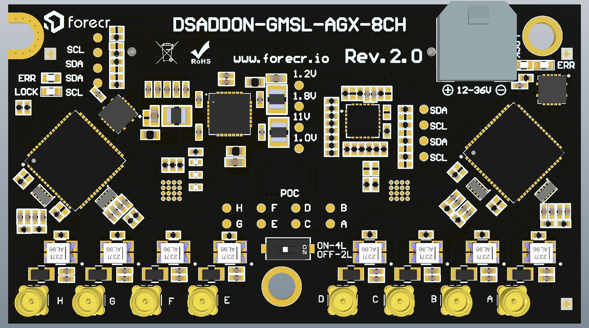
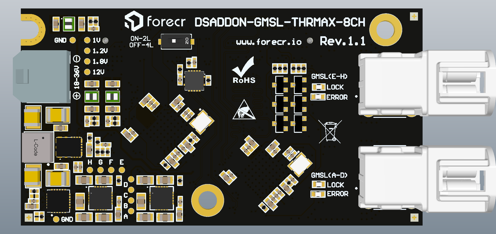
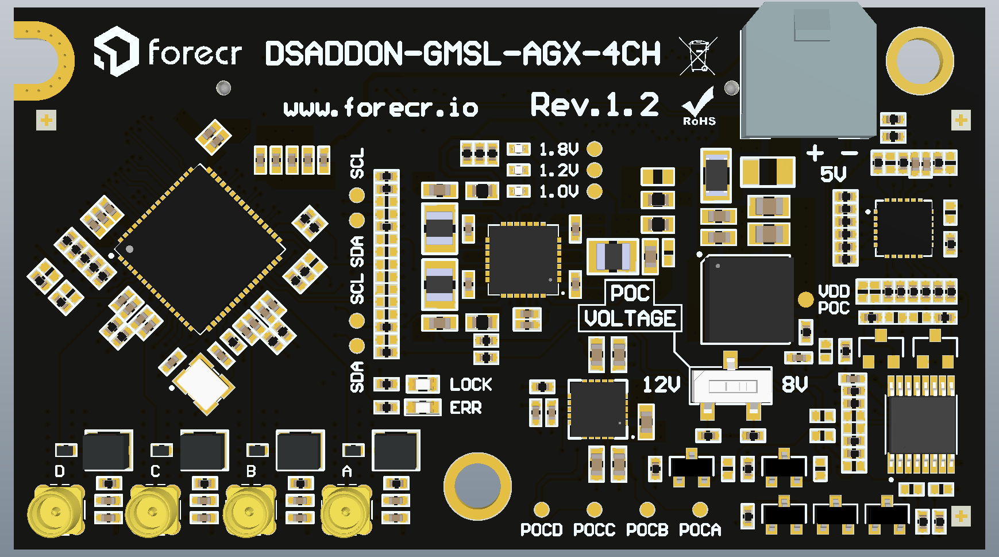
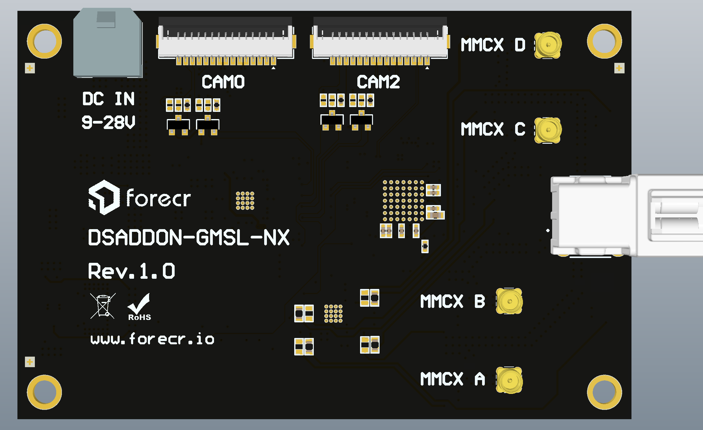
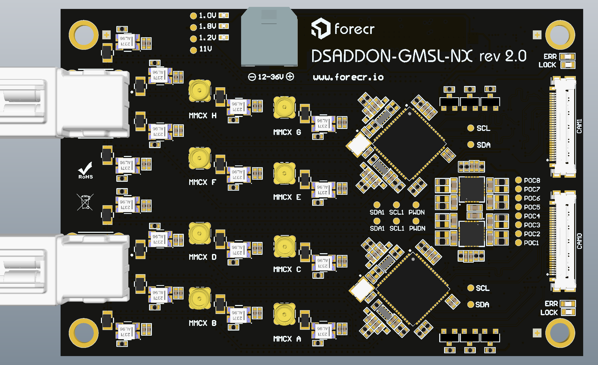
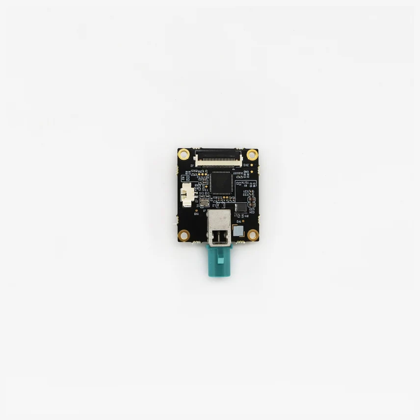

# jetson_gmsl_bsp

BSP packages for 4 and 8 channel GMSL board based forecr products

## ⚙️ Installation

1. Verify your platform (Orin / Thor) and the installed JetPack version:
   ```bash
   cat /etc/nv_tegra_release
   ```
2. Download the correct `.deb` file for your add-on board from the tables below. Packages in the `RT` rows are for the real-time (PREEMPT_RT) kernel.
3. Perform the installation:
   ```bash
   sudo dpkg -i stereolabs-forecr-*arm64.deb
   sudo reboot
   ```
4. After rebooting, check that the camera is detected:
   ```bash
   v4l2-ctl --list-devices
   ```
## ⚙️ Uninstallation

1. Remove the package then reboot:
   ```bash
   sudo dpkg -r stereolabs-forecr-*
   sudo reboot
   ```
## Install Argus
1.  Install related packages
  ```bash
  sudo apt install nvidia-l4t-jetson-multimedia-api cmake build-essential pkg-config libx11-dev libgtk-3-dev libexpat1-dev libjpeg-dev libgstreamer1.0-dev
  ```
2. Go to argus directory
  ```bash
  cd /usr/src/jetson_multimedia_api/argus/
  ```
3. Build and Install argus_camera
  ```bash
  mkdir build && cd build
  sudo cmake .. && sudo make -j $(nproc)
  sudo make install
  ```

## DSADDON-GMSL-AGX-8CH



> Driver version 1.4.4.

<table>
  <thead>
    <tr>
      <th align="center">JetPack Version</th>
      <th align="center">AGX Orin</th>
      <th align="center">Thor</th>
    </tr>
  </thead>
  <tbody>
    <tr>
      <td align="center"><b>7.2.1</b></td>
      <td align="center"><a href="releases/agx/stereolabs-forecr-agx-8ch-gmsl-for-agx_1.4.4-L4T39.2.0+hdrfix_arm64.deb">⬇ Download</a></td>
      <td align="center"><a href="releases/thor/stereolabs-forecr-agx-8ch-gmsl-for-thor_1.4.4-L4T39.2.0+hdrfix_arm64.deb">⬇ Download</a></td>
    </tr>
    <tr>
      <td align="center"><b>7.2.1 RT</b></td>
      <td align="center"><a href="releases/agx/stereolabs-forecr-agx-8ch-gmsl-for-agx_1.4.4-rt-L4T39.2.0+hdrfix_arm64.deb">⬇ Download</a></td>
      <td align="center"><a href="releases/thor/stereolabs-forecr-agx-8ch-gmsl-for-thor_1.4.4-rt-L4T39.2.0+hdrfix_arm64.deb">⬇ Download</a></td>
    </tr>
    <tr>
      <td align="center"><b>7.2</b></td>
      <td align="center"><a href="releases/agx/stereolabs-forecr-agx-8ch-gmsl-for-agx_1.4.4-L4T39.2.0+hdrfix_arm64.deb">⬇ Download</a></td>
      <td align="center"><a href="releases/thor/stereolabs-forecr-agx-8ch-gmsl-for-thor_1.4.4-L4T39.2.0+hdrfix_arm64.deb">⬇ Download</a></td>
    </tr>
    <tr>
      <td align="center"><b>7.2 RT</b></td>
      <td align="center"><a href="releases/agx/stereolabs-forecr-agx-8ch-gmsl-for-agx_1.4.4-rt-L4T39.2.0+hdrfix_arm64.deb">⬇ Download</a></td>
      <td align="center"><a href="releases/thor/stereolabs-forecr-agx-8ch-gmsl-for-thor_1.4.4-rt-L4T39.2.0+hdrfix_arm64.deb">⬇ Download</a></td>
    </tr>
    <tr>
      <td align="center"><b>7.1</b></td>
      <td align="center">—</td>
      <td align="center"><a href="releases/thor/stereolabs-forecr-agx-8ch-gmsl-for-thor_1.4.4-L4T38.4.1+hdrfix_arm64.deb">⬇ Download</a></td>
    </tr>
    <tr>
      <td align="center"><b>7.1 RT</b></td>
      <td align="center">—</td>
      <td align="center"><a href="releases/thor/stereolabs-forecr-agx-8ch-gmsl-for-thor_1.4.4-rt-L4T38.4.1+hdrfix_arm64.deb">⬇ Download</a></td>
    </tr>
    <tr>
      <td align="center"><b>7.0</b></td>
      <td align="center">—</td>
      <td align="center"><a href="releases/thor/stereolabs-forecr-agx-8ch-gmsl-for-thor_1.4.4-L4T38.2.1+hdrfix_arm64.deb">⬇ Download</a></td>
    </tr>
    <tr>
      <td align="center"><b>7.0 RT</b></td>
      <td align="center">—</td>
      <td align="center"><a href="releases/thor/stereolabs-forecr-agx-8ch-gmsl-for-thor_1.4.4-rt-L4T38.2.1+hdrfix_arm64.deb">⬇ Download</a></td>
    </tr>
    <tr>
      <td align="center"><b>6.2.3</b></td>
      <td align="center"><a href="releases/agx/stereolabs-forecr-agx-8ch-gmsl-for-agx_1.4.4-L4T36.5.2+hdrfix_arm64.deb">⬇ Download</a></td>
      <td align="center">—</td>
    </tr>
    <tr>
      <td align="center"><b>6.2.3 RT</b></td>
      <td align="center"><a href="releases/agx/stereolabs-forecr-agx-8ch-gmsl-for-agx_1.4.4-rt-L4T36.5.2+hdrfix_arm64.deb">⬇ Download</a></td>
      <td align="center">—</td>
    </tr>
    <tr>
      <td align="center"><b>6.2.2</b></td>
      <td align="center"><a href="releases/agx/stereolabs-forecr-agx-8ch-gmsl-for-agx_1.4.4-L4T36.5.0+hdrfix_arm64.deb">⬇ Download</a></td>
      <td align="center">—</td>
    </tr>
    <tr>
      <td align="center"><b>6.2.2 RT</b></td>
      <td align="center"><a href="releases/agx/stereolabs-forecr-agx-8ch-gmsl-for-agx_1.4.4-rt-L4T36.5.0+hdrfix_arm64.deb">⬇ Download</a></td>
      <td align="center">—</td>
    </tr>
    <tr>
      <td align="center"><b>6.2.1</b></td>
      <td align="center"><a href="releases/agx/stereolabs-forecr-agx-8ch-gmsl-for-agx_1.4.4-L4T36.4.0+hdrfix_arm64.deb">⬇ Download</a></td>
      <td align="center">—</td>
    </tr>
    <tr>
      <td align="center"><b>6.2.1 RT</b></td>
      <td align="center"><a href="releases/agx/stereolabs-forecr-agx-8ch-gmsl-for-agx_1.4.4-rt-L4T36.4.0+hdrfix_arm64.deb">⬇ Download</a></td>
      <td align="center">—</td>
    </tr>
    <tr>
      <td align="center"><b>6.2</b></td>
      <td align="center"><a href="releases/agx/stereolabs-forecr-agx-8ch-gmsl-for-agx_1.4.4-L4T36.4.0+hdrfix_arm64.deb">⬇ Download</a></td>
      <td align="center">—</td>
    </tr>
    <tr>
      <td align="center"><b>6.2 RT</b></td>
      <td align="center"><a href="releases/agx/stereolabs-forecr-agx-8ch-gmsl-for-agx_1.4.4-rt-L4T36.4.0+hdrfix_arm64.deb">⬇ Download</a></td>
      <td align="center">—</td>
    </tr>
    <tr>
      <td align="center"><b>6.1</b></td>
      <td align="center"><a href="releases/agx/stereolabs-forecr-agx-8ch-gmsl-for-agx_1.4.4-L4T36.4.0+hdrfix_arm64.deb">⬇ Download</a></td>
      <td align="center">—</td>
    </tr>
    <tr>
      <td align="center"><b>6.1 RT</b></td>
      <td align="center"><a href="releases/agx/stereolabs-forecr-agx-8ch-gmsl-for-agx_1.4.4-rt-L4T36.4.0+hdrfix_arm64.deb">⬇ Download</a></td>
      <td align="center">—</td>
    </tr>
    <tr>
      <td align="center"><b>6.0</b></td>
      <td align="center"><a href="releases/agx/stereolabs-forecr-agx-8ch-gmsl-for-agx_1.4.4-L4T36.3.0+hdrfix_arm64.deb">⬇ Download</a></td>
      <td align="center">—</td>
    </tr>
    <tr>
      <td align="center"><b>6.0 RT</b></td>
      <td align="center"><a href="releases/agx/stereolabs-forecr-agx-8ch-gmsl-for-agx_1.4.4-rt-L4T36.3.0+hdrfix_arm64.deb">⬇ Download</a></td>
      <td align="center">—</td>
    </tr>
  </tbody>
</table>

## DSADDON-GMSL-THRMAX-8CH



> Driver version 1.4.4.

<table>
  <thead>
    <tr>
      <th align="center">JetPack Version</th>
      <th align="center">AGX Orin</th>
      <th align="center">Thor</th>
    </tr>
  </thead>
  <tbody>
    <tr>
      <td align="center"><b>7.2.1</b></td>
      <td align="center"><a href="releases/agx/stereolabs-forecr-thrmax-8ch-gmsl-for-agx_1.4.4-L4T39.2.0+hdrfix_arm64.deb">⬇ Download</a></td>
      <td align="center"><a href="releases/thor/stereolabs-forecr-thrmax-8ch-gmsl-for-thor_1.4.4-L4T39.2.0+hdrfix_arm64.deb">⬇ Download</a></td>
    </tr>
    <tr>
      <td align="center"><b>7.2.1 RT</b></td>
      <td align="center"><a href="releases/agx/stereolabs-forecr-thrmax-8ch-gmsl-for-agx_1.4.4-rt-L4T39.2.0+hdrfix_arm64.deb">⬇ Download</a></td>
      <td align="center"><a href="releases/thor/stereolabs-forecr-thrmax-8ch-gmsl-for-thor_1.4.4-rt-L4T39.2.0+hdrfix_arm64.deb">⬇ Download</a></td>
    </tr>
    <tr>
      <td align="center"><b>7.2</b></td>
      <td align="center"><a href="releases/agx/stereolabs-forecr-thrmax-8ch-gmsl-for-agx_1.4.4-L4T39.2.0+hdrfix_arm64.deb">⬇ Download</a></td>
      <td align="center"><a href="releases/thor/stereolabs-forecr-thrmax-8ch-gmsl-for-thor_1.4.4-L4T39.2.0+hdrfix_arm64.deb">⬇ Download</a></td>
    </tr>
    <tr>
      <td align="center"><b>7.2 RT</b></td>
      <td align="center"><a href="releases/agx/stereolabs-forecr-thrmax-8ch-gmsl-for-agx_1.4.4-rt-L4T39.2.0+hdrfix_arm64.deb">⬇ Download</a></td>
      <td align="center"><a href="releases/thor/stereolabs-forecr-thrmax-8ch-gmsl-for-thor_1.4.4-rt-L4T39.2.0+hdrfix_arm64.deb">⬇ Download</a></td>
    </tr>
    <tr>
      <td align="center"><b>7.1</b></td>
      <td align="center">—</td>
      <td align="center"><a href="releases/thor/stereolabs-forecr-thrmax-8ch-gmsl-for-thor_1.4.4-L4T38.4.1+hdrfix_arm64.deb">⬇ Download</a></td>
    </tr>
    <tr>
      <td align="center"><b>7.1 RT</b></td>
      <td align="center">—</td>
      <td align="center"><a href="releases/thor/stereolabs-forecr-thrmax-8ch-gmsl-for-thor_1.4.4-rt-L4T38.4.1+hdrfix_arm64.deb">⬇ Download</a></td>
    </tr>
    <tr>
      <td align="center"><b>7.0</b></td>
      <td align="center">—</td>
      <td align="center"><a href="releases/thor/stereolabs-forecr-thrmax-8ch-gmsl-for-thor_1.4.4-L4T38.2.1+hdrfix_arm64.deb">⬇ Download</a></td>
    </tr>
    <tr>
      <td align="center"><b>7.0 RT</b></td>
      <td align="center">—</td>
      <td align="center"><a href="releases/thor/stereolabs-forecr-thrmax-8ch-gmsl-for-thor_1.4.4-rt-L4T38.2.1+hdrfix_arm64.deb">⬇ Download</a></td>
    </tr>
    <tr>
      <td align="center"><b>6.2.3</b></td>
      <td align="center"><a href="releases/agx/stereolabs-forecr-thrmax-8ch-gmsl-for-agx_1.4.4-L4T36.5.2+hdrfix_arm64.deb">⬇ Download</a></td>
      <td align="center">—</td>
    </tr>
    <tr>
      <td align="center"><b>6.2.3 RT</b></td>
      <td align="center"><a href="releases/agx/stereolabs-forecr-thrmax-8ch-gmsl-for-agx_1.4.4-rt-L4T36.5.2+hdrfix_arm64.deb">⬇ Download</a></td>
      <td align="center">—</td>
    </tr>
    <tr>
      <td align="center"><b>6.2.2</b></td>
      <td align="center"><a href="releases/agx/stereolabs-forecr-thrmax-8ch-gmsl-for-agx_1.4.4-L4T36.5.0+hdrfix_arm64.deb">⬇ Download</a></td>
      <td align="center">—</td>
    </tr>
    <tr>
      <td align="center"><b>6.2.2 RT</b></td>
      <td align="center"><a href="releases/agx/stereolabs-forecr-thrmax-8ch-gmsl-for-agx_1.4.4-rt-L4T36.5.0+hdrfix_arm64.deb">⬇ Download</a></td>
      <td align="center">—</td>
    </tr>
    <tr>
      <td align="center"><b>6.2.1</b></td>
      <td align="center"><a href="releases/agx/stereolabs-forecr-thrmax-8ch-gmsl-for-agx_1.4.4-L4T36.4.0+hdrfix_arm64.deb">⬇ Download</a></td>
      <td align="center">—</td>
    </tr>
    <tr>
      <td align="center"><b>6.2.1 RT</b></td>
      <td align="center"><a href="releases/agx/stereolabs-forecr-thrmax-8ch-gmsl-for-agx_1.4.4-rt-L4T36.4.0+hdrfix_arm64.deb">⬇ Download</a></td>
      <td align="center">—</td>
    </tr>
    <tr>
      <td align="center"><b>6.2</b></td>
      <td align="center"><a href="releases/agx/stereolabs-forecr-thrmax-8ch-gmsl-for-agx_1.4.4-L4T36.4.0+hdrfix_arm64.deb">⬇ Download</a></td>
      <td align="center">—</td>
    </tr>
    <tr>
      <td align="center"><b>6.2 RT</b></td>
      <td align="center"><a href="releases/agx/stereolabs-forecr-thrmax-8ch-gmsl-for-agx_1.4.4-rt-L4T36.4.0+hdrfix_arm64.deb">⬇ Download</a></td>
      <td align="center">—</td>
    </tr>
    <tr>
      <td align="center"><b>6.1</b></td>
      <td align="center"><a href="releases/agx/stereolabs-forecr-thrmax-8ch-gmsl-for-agx_1.4.4-L4T36.4.0+hdrfix_arm64.deb">⬇ Download</a></td>
      <td align="center">—</td>
    </tr>
    <tr>
      <td align="center"><b>6.1 RT</b></td>
      <td align="center"><a href="releases/agx/stereolabs-forecr-thrmax-8ch-gmsl-for-agx_1.4.4-rt-L4T36.4.0+hdrfix_arm64.deb">⬇ Download</a></td>
      <td align="center">—</td>
    </tr>
    <tr>
      <td align="center"><b>6.0</b></td>
      <td align="center"><a href="releases/agx/stereolabs-forecr-thrmax-8ch-gmsl-for-agx_1.4.4-L4T36.3.0+hdrfix_arm64.deb">⬇ Download</a></td>
      <td align="center">—</td>
    </tr>
    <tr>
      <td align="center"><b>6.0 RT</b></td>
      <td align="center"><a href="releases/agx/stereolabs-forecr-thrmax-8ch-gmsl-for-agx_1.4.4-rt-L4T36.3.0+hdrfix_arm64.deb">⬇ Download</a></td>
      <td align="center">—</td>
    </tr>
  </tbody>
</table>

## DSADDON-GMSL-AGX-4CH



> Driver version 1.4.4. On RAIBOARD-ORNX and MILBOARD-ORNX carriers the Orin NX/Nano package selects the matching overlay automatically during installation.

<table>
  <thead>
    <tr>
      <th align="center">JetPack Version</th>
      <th align="center">AGX Orin</th>
      <th align="center">Orin NX/Nano</th>
      <th align="center">Thor</th>
    </tr>
  </thead>
  <tbody>
    <tr>
      <td align="center"><b>7.2.1</b></td>
      <td align="center"><a href="releases/agx/stereolabs-forecr-agx-4ch-gmsl-for-agx_1.4.4-L4T39.2.0_arm64.deb">⬇ Download</a></td>
      <td align="center"><a href="releases/ornx/stereolabs-forecr-agx-4ch-gmsl-for-ornx_1.4.4-L4T39.2.0_arm64.deb">⬇ Download</a></td>
      <td align="center"><a href="releases/thor/stereolabs-forecr-agx-4ch-gmsl-for-thor_1.4.4-L4T39.2.0_arm64.deb">⬇ Download</a></td>
    </tr>
    <tr>
      <td align="center"><b>7.2.1 RT</b></td>
      <td align="center"><a href="releases/agx/stereolabs-forecr-agx-4ch-gmsl-for-agx_1.4.4-rt-L4T39.2.0_arm64.deb">⬇ Download</a></td>
      <td align="center"><a href="releases/ornx/stereolabs-forecr-agx-4ch-gmsl-for-ornx_1.4.4-rt-L4T39.2.0_arm64.deb">⬇ Download</a></td>
      <td align="center"><a href="releases/thor/stereolabs-forecr-agx-4ch-gmsl-for-thor_1.4.4-rt-L4T39.2.0_arm64.deb">⬇ Download</a></td>
    </tr>
    <tr>
      <td align="center"><b>7.2</b></td>
      <td align="center"><a href="releases/agx/stereolabs-forecr-agx-4ch-gmsl-for-agx_1.4.4-L4T39.2.0_arm64.deb">⬇ Download</a></td>
      <td align="center"><a href="releases/ornx/stereolabs-forecr-agx-4ch-gmsl-for-ornx_1.4.4-L4T39.2.0_arm64.deb">⬇ Download</a></td>
      <td align="center"><a href="releases/thor/stereolabs-forecr-agx-4ch-gmsl-for-thor_1.4.4-L4T39.2.0_arm64.deb">⬇ Download</a></td>
    </tr>
    <tr>
      <td align="center"><b>7.2 RT</b></td>
      <td align="center"><a href="releases/agx/stereolabs-forecr-agx-4ch-gmsl-for-agx_1.4.4-rt-L4T39.2.0_arm64.deb">⬇ Download</a></td>
      <td align="center"><a href="releases/ornx/stereolabs-forecr-agx-4ch-gmsl-for-ornx_1.4.4-rt-L4T39.2.0_arm64.deb">⬇ Download</a></td>
      <td align="center"><a href="releases/thor/stereolabs-forecr-agx-4ch-gmsl-for-thor_1.4.4-rt-L4T39.2.0_arm64.deb">⬇ Download</a></td>
    </tr>
    <tr>
      <td align="center"><b>7.1</b></td>
      <td align="center">—</td>
      <td align="center">—</td>
      <td align="center"><a href="releases/thor/stereolabs-forecr-agx-4ch-gmsl-for-thor_1.4.4-L4T38.4.1_arm64.deb">⬇ Download</a></td>
    </tr>
    <tr>
      <td align="center"><b>7.1 RT</b></td>
      <td align="center">—</td>
      <td align="center">—</td>
      <td align="center"><a href="releases/thor/stereolabs-forecr-agx-4ch-gmsl-for-thor_1.4.4-rt-L4T38.4.1_arm64.deb">⬇ Download</a></td>
    </tr>
    <tr>
      <td align="center"><b>7.0</b></td>
      <td align="center">—</td>
      <td align="center">—</td>
      <td align="center"><a href="releases/thor/stereolabs-forecr-agx-4ch-gmsl-for-thor_1.4.4-L4T38.2.1_arm64.deb">⬇ Download</a></td>
    </tr>
    <tr>
      <td align="center"><b>7.0 RT</b></td>
      <td align="center">—</td>
      <td align="center">—</td>
      <td align="center"><a href="releases/thor/stereolabs-forecr-agx-4ch-gmsl-for-thor_1.4.4-rt-L4T38.2.1_arm64.deb">⬇ Download</a></td>
    </tr>
    <tr>
      <td align="center"><b>6.2.3</b></td>
      <td align="center"><a href="releases/agx/stereolabs-forecr-agx-4ch-gmsl-for-agx_1.4.4-L4T36.5.2_arm64.deb">⬇ Download</a></td>
      <td align="center"><a href="releases/ornx/stereolabs-forecr-agx-4ch-gmsl-for-ornx_1.4.4-L4T36.5.2_arm64.deb">⬇ Download</a></td>
      <td align="center">—</td>
    </tr>
    <tr>
      <td align="center"><b>6.2.3 RT</b></td>
      <td align="center"><a href="releases/agx/stereolabs-forecr-agx-4ch-gmsl-for-agx_1.4.4-rt-L4T36.5.2_arm64.deb">⬇ Download</a></td>
      <td align="center"><a href="releases/ornx/stereolabs-forecr-agx-4ch-gmsl-for-ornx_1.4.4-rt-L4T36.5.2_arm64.deb">⬇ Download</a></td>
      <td align="center">—</td>
    </tr>
    <tr>
      <td align="center"><b>6.2.2</b></td>
      <td align="center"><a href="releases/agx/stereolabs-forecr-agx-4ch-gmsl-for-agx_1.4.4-L4T36.5.0_arm64.deb">⬇ Download</a></td>
      <td align="center"><a href="releases/ornx/stereolabs-forecr-agx-4ch-gmsl-for-ornx_1.4.4-L4T36.5.0_arm64.deb">⬇ Download</a></td>
      <td align="center">—</td>
    </tr>
    <tr>
      <td align="center"><b>6.2.2 RT</b></td>
      <td align="center"><a href="releases/agx/stereolabs-forecr-agx-4ch-gmsl-for-agx_1.4.4-rt-L4T36.5.0_arm64.deb">⬇ Download</a></td>
      <td align="center"><a href="releases/ornx/stereolabs-forecr-agx-4ch-gmsl-for-ornx_1.4.4-rt-L4T36.5.0_arm64.deb">⬇ Download</a></td>
      <td align="center">—</td>
    </tr>
    <tr>
      <td align="center"><b>6.2.1</b></td>
      <td align="center"><a href="releases/agx/stereolabs-forecr-agx-4ch-gmsl-for-agx_1.4.4-L4T36.4.0_arm64.deb">⬇ Download</a></td>
      <td align="center"><a href="releases/ornx/stereolabs-forecr-agx-4ch-gmsl-for-ornx_1.4.4-L4T36.4.0_arm64.deb">⬇ Download</a></td>
      <td align="center">—</td>
    </tr>
    <tr>
      <td align="center"><b>6.2.1 RT</b></td>
      <td align="center"><a href="releases/agx/stereolabs-forecr-agx-4ch-gmsl-for-agx_1.4.4-rt-L4T36.4.0_arm64.deb">⬇ Download</a></td>
      <td align="center"><a href="releases/ornx/stereolabs-forecr-agx-4ch-gmsl-for-ornx_1.4.4-rt-L4T36.4.0_arm64.deb">⬇ Download</a></td>
      <td align="center">—</td>
    </tr>
    <tr>
      <td align="center"><b>6.2</b></td>
      <td align="center"><a href="releases/agx/stereolabs-forecr-agx-4ch-gmsl-for-agx_1.4.4-L4T36.4.0_arm64.deb">⬇ Download</a></td>
      <td align="center"><a href="releases/ornx/stereolabs-forecr-agx-4ch-gmsl-for-ornx_1.4.4-L4T36.4.0_arm64.deb">⬇ Download</a></td>
      <td align="center">—</td>
    </tr>
    <tr>
      <td align="center"><b>6.2 RT</b></td>
      <td align="center"><a href="releases/agx/stereolabs-forecr-agx-4ch-gmsl-for-agx_1.4.4-rt-L4T36.4.0_arm64.deb">⬇ Download</a></td>
      <td align="center"><a href="releases/ornx/stereolabs-forecr-agx-4ch-gmsl-for-ornx_1.4.4-rt-L4T36.4.0_arm64.deb">⬇ Download</a></td>
      <td align="center">—</td>
    </tr>
    <tr>
      <td align="center"><b>6.1</b></td>
      <td align="center"><a href="releases/agx/stereolabs-forecr-agx-4ch-gmsl-for-agx_1.4.4-L4T36.4.0_arm64.deb">⬇ Download</a></td>
      <td align="center"><a href="releases/ornx/stereolabs-forecr-agx-4ch-gmsl-for-ornx_1.4.4-L4T36.4.0_arm64.deb">⬇ Download</a></td>
      <td align="center">—</td>
    </tr>
    <tr>
      <td align="center"><b>6.1 RT</b></td>
      <td align="center"><a href="releases/agx/stereolabs-forecr-agx-4ch-gmsl-for-agx_1.4.4-rt-L4T36.4.0_arm64.deb">⬇ Download</a></td>
      <td align="center"><a href="releases/ornx/stereolabs-forecr-agx-4ch-gmsl-for-ornx_1.4.4-rt-L4T36.4.0_arm64.deb">⬇ Download</a></td>
      <td align="center">—</td>
    </tr>
    <tr>
      <td align="center"><b>6.0</b></td>
      <td align="center"><a href="releases/agx/stereolabs-forecr-agx-4ch-gmsl-for-agx_1.4.4-L4T36.3.0_arm64.deb">⬇ Download</a></td>
      <td align="center"><a href="releases/ornx/stereolabs-forecr-agx-4ch-gmsl-for-ornx_1.4.4-L4T36.3.0_arm64.deb">⬇ Download</a></td>
      <td align="center">—</td>
    </tr>
    <tr>
      <td align="center"><b>6.0 RT</b></td>
      <td align="center"><a href="releases/agx/stereolabs-forecr-agx-4ch-gmsl-for-agx_1.4.4-rt-L4T36.3.0_arm64.deb">⬇ Download</a></td>
      <td align="center"><a href="releases/ornx/stereolabs-forecr-agx-4ch-gmsl-for-ornx_1.4.4-rt-L4T36.3.0_arm64.deb">⬇ Download</a></td>
      <td align="center">—</td>
    </tr>
  </tbody>
</table>


## DSADDON-GMSL-NX Rev1.0



> Driver version 1.4.4 for DSADDON-GMSL-NX Rev1.0.
>
> - The default overlay is the 4-cable connection. On DSBOARD-ORNXS the matching overlay is selected automatically during installation.
> - For the 2-cable connection, the overlay `tegra234-p3768-camera-forecr-gmsl-nx-4ch-2cable-sl-for-ornx-overlay.dtbo` is installed under `/boot/stereolabs/`. Set it in the `OVERLAYS` line of `/boot/extlinux/extlinux.conf` and reboot.

<table>
  <thead>
    <tr>
      <th align="center">JetPack Version</th>
      <th align="center">Orin NX/Nano</th>
    </tr>
  </thead>
  <tbody>
    <tr>
      <td align="center"><b>7.2.1</b></td>
      <td align="center"><a href="releases/ornx/stereolabs-forecr-gmsl-nx-for-ornx_1.4.4-L4T39.2.0+rev10.ornxs_arm64.deb">⬇ Download</a></td>
    </tr>
    <tr>
      <td align="center"><b>7.2.1 RT</b></td>
      <td align="center"><a href="releases/ornx/stereolabs-forecr-gmsl-nx-for-ornx_1.4.4-rt-L4T39.2.0+rev10.ornxs_arm64.deb">⬇ Download</a></td>
    </tr>
    <tr>
      <td align="center"><b>7.2</b></td>
      <td align="center"><a href="releases/ornx/stereolabs-forecr-gmsl-nx-for-ornx_1.4.4-L4T39.2.0+rev10.ornxs_arm64.deb">⬇ Download</a></td>
    </tr>
    <tr>
      <td align="center"><b>7.2 RT</b></td>
      <td align="center"><a href="releases/ornx/stereolabs-forecr-gmsl-nx-for-ornx_1.4.4-rt-L4T39.2.0+rev10.ornxs_arm64.deb">⬇ Download</a></td>
    </tr>
    <tr>
      <td align="center"><b>6.2.3</b></td>
      <td align="center"><a href="releases/ornx/stereolabs-forecr-gmsl-nx-for-ornx_1.4.4-L4T36.5.2+rev10.ornxs_arm64.deb">⬇ Download</a></td>
    </tr>
    <tr>
      <td align="center"><b>6.2.3 RT</b></td>
      <td align="center"><a href="releases/ornx/stereolabs-forecr-gmsl-nx-for-ornx_1.4.4-rt-L4T36.5.2+rev10.ornxs_arm64.deb">⬇ Download</a></td>
    </tr>
    <tr>
      <td align="center"><b>6.2.2</b></td>
      <td align="center"><a href="releases/ornx/stereolabs-forecr-gmsl-nx-for-ornx_1.4.4-L4T36.5.0+rev10.ornxs_arm64.deb">⬇ Download</a></td>
    </tr>
    <tr>
      <td align="center"><b>6.2.2 RT</b></td>
      <td align="center"><a href="releases/ornx/stereolabs-forecr-gmsl-nx-for-ornx_1.4.4-rt-L4T36.5.0+rev10.ornxs_arm64.deb">⬇ Download</a></td>
    </tr>
    <tr>
      <td align="center"><b>6.2.1</b></td>
      <td align="center"><a href="releases/ornx/stereolabs-forecr-gmsl-nx-for-ornx_1.4.4-L4T36.4.0+rev10.ornxs_arm64.deb">⬇ Download</a></td>
    </tr>
    <tr>
      <td align="center"><b>6.2.1 RT</b></td>
      <td align="center"><a href="releases/ornx/stereolabs-forecr-gmsl-nx-for-ornx_1.4.4-rt-L4T36.4.0+rev10.ornxs_arm64.deb">⬇ Download</a></td>
    </tr>
    <tr>
      <td align="center"><b>6.2</b></td>
      <td align="center"><a href="releases/ornx/stereolabs-forecr-gmsl-nx-for-ornx_1.4.4-L4T36.4.0+rev10.ornxs_arm64.deb">⬇ Download</a></td>
    </tr>
    <tr>
      <td align="center"><b>6.2 RT</b></td>
      <td align="center"><a href="releases/ornx/stereolabs-forecr-gmsl-nx-for-ornx_1.4.4-rt-L4T36.4.0+rev10.ornxs_arm64.deb">⬇ Download</a></td>
    </tr>
    <tr>
      <td align="center"><b>6.1</b></td>
      <td align="center"><a href="releases/ornx/stereolabs-forecr-gmsl-nx-for-ornx_1.4.4-L4T36.4.0+rev10.ornxs_arm64.deb">⬇ Download</a></td>
    </tr>
    <tr>
      <td align="center"><b>6.1 RT</b></td>
      <td align="center"><a href="releases/ornx/stereolabs-forecr-gmsl-nx-for-ornx_1.4.4-rt-L4T36.4.0+rev10.ornxs_arm64.deb">⬇ Download</a></td>
    </tr>
    <tr>
      <td align="center"><b>6.0</b></td>
      <td align="center"><a href="releases/ornx/stereolabs-forecr-gmsl-nx-for-ornx_1.4.4-L4T36.3.0+rev10.ornxs_arm64.deb">⬇ Download</a></td>
    </tr>
    <tr>
      <td align="center"><b>6.0 RT</b></td>
      <td align="center"><a href="releases/ornx/stereolabs-forecr-gmsl-nx-for-ornx_1.4.4-rt-L4T36.3.0+rev10.ornxs_arm64.deb">⬇ Download</a></td>
    </tr>
  </tbody>
</table>


## DSADDON-GMSL-NX Rev2.0



> Driver version 1.4.4 for DSADDON-GMSL-NX Rev2.0 (8 channels, two MAX96712).
>
> - The default overlay `tegra234-p3768-camera-forecr-gmsl-nx-8ch-sl-for-ornx-overlay.dtbo` is for DSBOARD-ORNXS.
> - On DSBOARD-ORNX and DSBOARD-ORNX-LAN the overlay `tegra234-p3768-camera-forecr-gmsl-nx-8ch-sl-for-dsboard-ornx-overlay.dtbo` is selected automatically during installation.

<table>
  <thead>
    <tr>
      <th align="center">JetPack Version</th>
      <th align="center">Orin NX/Nano</th>
    </tr>
  </thead>
  <tbody>
    <tr>
      <td align="center"><b>7.2.1</b></td>
      <td align="center"><a href="releases/ornx/stereolabs-forecr-gmsl-nx-8ch-for-ornx_1.4.4-L4T39.2.0_arm64.deb">⬇ Download</a></td>
    </tr>
    <tr>
      <td align="center"><b>7.2.1 RT</b></td>
      <td align="center"><a href="releases/ornx/stereolabs-forecr-gmsl-nx-8ch-for-ornx_1.4.4-rt-L4T39.2.0_arm64.deb">⬇ Download</a></td>
    </tr>
    <tr>
      <td align="center"><b>7.2</b></td>
      <td align="center"><a href="releases/ornx/stereolabs-forecr-gmsl-nx-8ch-for-ornx_1.4.4-L4T39.2.0_arm64.deb">⬇ Download</a></td>
    </tr>
    <tr>
      <td align="center"><b>7.2 RT</b></td>
      <td align="center"><a href="releases/ornx/stereolabs-forecr-gmsl-nx-8ch-for-ornx_1.4.4-rt-L4T39.2.0_arm64.deb">⬇ Download</a></td>
    </tr>
    <tr>
      <td align="center"><b>6.2.3</b></td>
      <td align="center"><a href="releases/ornx/stereolabs-forecr-gmsl-nx-8ch-for-ornx_1.4.4-L4T36.5.2_arm64.deb">⬇ Download</a></td>
    </tr>
    <tr>
      <td align="center"><b>6.2.3 RT</b></td>
      <td align="center"><a href="releases/ornx/stereolabs-forecr-gmsl-nx-8ch-for-ornx_1.4.4-rt-L4T36.5.2_arm64.deb">⬇ Download</a></td>
    </tr>
    <tr>
      <td align="center"><b>6.2.2</b></td>
      <td align="center"><a href="releases/ornx/stereolabs-forecr-gmsl-nx-8ch-for-ornx_1.4.4-L4T36.5.0_arm64.deb">⬇ Download</a></td>
    </tr>
    <tr>
      <td align="center"><b>6.2.2 RT</b></td>
      <td align="center"><a href="releases/ornx/stereolabs-forecr-gmsl-nx-8ch-for-ornx_1.4.4-rt-L4T36.5.0_arm64.deb">⬇ Download</a></td>
    </tr>
    <tr>
      <td align="center"><b>6.2.1</b></td>
      <td align="center"><a href="releases/ornx/stereolabs-forecr-gmsl-nx-8ch-for-ornx_1.4.4-L4T36.4.0_arm64.deb">⬇ Download</a></td>
    </tr>
    <tr>
      <td align="center"><b>6.2.1 RT</b></td>
      <td align="center"><a href="releases/ornx/stereolabs-forecr-gmsl-nx-8ch-for-ornx_1.4.4-rt-L4T36.4.0_arm64.deb">⬇ Download</a></td>
    </tr>
    <tr>
      <td align="center"><b>6.2</b></td>
      <td align="center"><a href="releases/ornx/stereolabs-forecr-gmsl-nx-8ch-for-ornx_1.4.4-L4T36.4.0_arm64.deb">⬇ Download</a></td>
    </tr>
    <tr>
      <td align="center"><b>6.2 RT</b></td>
      <td align="center"><a href="releases/ornx/stereolabs-forecr-gmsl-nx-8ch-for-ornx_1.4.4-rt-L4T36.4.0_arm64.deb">⬇ Download</a></td>
    </tr>
    <tr>
      <td align="center"><b>6.1</b></td>
      <td align="center"><a href="releases/ornx/stereolabs-forecr-gmsl-nx-8ch-for-ornx_1.4.4-L4T36.4.0_arm64.deb">⬇ Download</a></td>
    </tr>
    <tr>
      <td align="center"><b>6.1 RT</b></td>
      <td align="center"><a href="releases/ornx/stereolabs-forecr-gmsl-nx-8ch-for-ornx_1.4.4-rt-L4T36.4.0_arm64.deb">⬇ Download</a></td>
    </tr>
    <tr>
      <td align="center"><b>6.0</b></td>
      <td align="center"><a href="releases/ornx/stereolabs-forecr-gmsl-nx-8ch-for-ornx_1.4.4-L4T36.3.0_arm64.deb">⬇ Download</a></td>
    </tr>
    <tr>
      <td align="center"><b>6.0 RT</b></td>
      <td align="center"><a href="releases/ornx/stereolabs-forecr-gmsl-nx-8ch-for-ornx_1.4.4-rt-L4T36.3.0_arm64.deb">⬇ Download</a></td>
    </tr>
  </tbody>
</table>


## ZED Link Mono on DSBOARD-ORNX / DSBOARD-ORNXS



> Driver version 1.4.4 for a ZED Link Mono capture card connected to the CSI connector of the carrier board. On DSBOARD-ORNXS the matching overlay is selected automatically during installation.

<table>
  <thead>
    <tr>
      <th align="center">JetPack Version</th>
      <th align="center">Orin NX/Nano</th>
    </tr>
  </thead>
  <tbody>
    <tr>
      <td align="center"><b>7.2.1</b></td>
      <td align="center"><a href="releases/ornx/stereolabs-forecr-zedx-mono-1ch-gmsl-for-ornx_1.4.4-L4T39.2.0+ornxs_arm64.deb">⬇ Download</a></td>
    </tr>
    <tr>
      <td align="center"><b>7.2.1 RT</b></td>
      <td align="center"><a href="releases/ornx/stereolabs-forecr-zedx-mono-1ch-gmsl-for-ornx_1.4.4-rt-L4T39.2.0+ornxs_arm64.deb">⬇ Download</a></td>
    </tr>
    <tr>
      <td align="center"><b>7.2</b></td>
      <td align="center"><a href="releases/ornx/stereolabs-forecr-zedx-mono-1ch-gmsl-for-ornx_1.4.4-L4T39.2.0+ornxs_arm64.deb">⬇ Download</a></td>
    </tr>
    <tr>
      <td align="center"><b>7.2 RT</b></td>
      <td align="center"><a href="releases/ornx/stereolabs-forecr-zedx-mono-1ch-gmsl-for-ornx_1.4.4-rt-L4T39.2.0+ornxs_arm64.deb">⬇ Download</a></td>
    </tr>
    <tr>
      <td align="center"><b>6.2.3</b></td>
      <td align="center"><a href="releases/ornx/stereolabs-forecr-zedx-mono-1ch-gmsl-for-ornx_1.4.4-L4T36.5.2+ornxs_arm64.deb">⬇ Download</a></td>
    </tr>
    <tr>
      <td align="center"><b>6.2.3 RT</b></td>
      <td align="center"><a href="releases/ornx/stereolabs-forecr-zedx-mono-1ch-gmsl-for-ornx_1.4.4-rt-L4T36.5.2+ornxs_arm64.deb">⬇ Download</a></td>
    </tr>
    <tr>
      <td align="center"><b>6.2.2</b></td>
      <td align="center"><a href="releases/ornx/stereolabs-forecr-zedx-mono-1ch-gmsl-for-ornx_1.4.4-L4T36.5.0+ornxs_arm64.deb">⬇ Download</a></td>
    </tr>
    <tr>
      <td align="center"><b>6.2.2 RT</b></td>
      <td align="center"><a href="releases/ornx/stereolabs-forecr-zedx-mono-1ch-gmsl-for-ornx_1.4.4-rt-L4T36.5.0+ornxs_arm64.deb">⬇ Download</a></td>
    </tr>
    <tr>
      <td align="center"><b>6.2.1</b></td>
      <td align="center"><a href="releases/ornx/stereolabs-forecr-zedx-mono-1ch-gmsl-for-ornx_1.4.4-L4T36.4.0+ornxs_arm64.deb">⬇ Download</a></td>
    </tr>
    <tr>
      <td align="center"><b>6.2.1 RT</b></td>
      <td align="center"><a href="releases/ornx/stereolabs-forecr-zedx-mono-1ch-gmsl-for-ornx_1.4.4-rt-L4T36.4.0+ornxs_arm64.deb">⬇ Download</a></td>
    </tr>
    <tr>
      <td align="center"><b>6.2</b></td>
      <td align="center"><a href="releases/ornx/stereolabs-forecr-zedx-mono-1ch-gmsl-for-ornx_1.4.4-L4T36.4.0+ornxs_arm64.deb">⬇ Download</a></td>
    </tr>
    <tr>
      <td align="center"><b>6.2 RT</b></td>
      <td align="center"><a href="releases/ornx/stereolabs-forecr-zedx-mono-1ch-gmsl-for-ornx_1.4.4-rt-L4T36.4.0+ornxs_arm64.deb">⬇ Download</a></td>
    </tr>
    <tr>
      <td align="center"><b>6.1</b></td>
      <td align="center"><a href="releases/ornx/stereolabs-forecr-zedx-mono-1ch-gmsl-for-ornx_1.4.4-L4T36.4.0+ornxs_arm64.deb">⬇ Download</a></td>
    </tr>
    <tr>
      <td align="center"><b>6.1 RT</b></td>
      <td align="center"><a href="releases/ornx/stereolabs-forecr-zedx-mono-1ch-gmsl-for-ornx_1.4.4-rt-L4T36.4.0+ornxs_arm64.deb">⬇ Download</a></td>
    </tr>
    <tr>
      <td align="center"><b>6.0</b></td>
      <td align="center"><a href="releases/ornx/stereolabs-forecr-zedx-mono-1ch-gmsl-for-ornx_1.4.4-L4T36.3.0+ornxs_arm64.deb">⬇ Download</a></td>
    </tr>
    <tr>
      <td align="center"><b>6.0 RT</b></td>
      <td align="center"><a href="releases/ornx/stereolabs-forecr-zedx-mono-1ch-gmsl-for-ornx_1.4.4-rt-L4T36.3.0+ornxs_arm64.deb">⬇ Download</a></td>
    </tr>
  </tbody>
</table>


## ZED SDK
<table>
  <thead>
    <tr>
      <th align="center">JetPack Version</th>
      <th align="center">Latest Version</th>
    </tr>
  </thead>
  <tbody>
    <tr>
      <td align="center"><b>7.2</b></td>
      <td align="center"><a href="releases/zed-sdk/ZED_SDK_Tegra_L4T39.2_v5.6.0.zstd.run">⬇ Zed SDK 5.6.0</a></td>
    </tr>
    <tr>
      <td align="center"><b>7.1</b></td>
      <td align="center"><a href="releases/zed-sdk/ZED_SDK_Tegra_L4T38.4_v5.6.0.zstd.run">⬇ Zed SDK 5.6.0</a></td>
    </tr>
    <tr>
      <td align="center"><b>7.0</b></td>
      <td align="center"><a href="releases/zed-sdk/ZED_SDK_Tegra_L4T38.2_v5.6.0.zstd.run">⬇ Zed SDK 5.6.0</a></td>
    </tr>
    <tr>
      <td align="center"><b>6.2.2</b></td>
      <td align="center"><a href="releases/zed-sdk/ZED_SDK_Tegra_L4T36.5_v5.6.0.zstd.run">⬇ Zed SDK 5.6.0</a></td>
    </tr>
    <tr>
      <td align="center"><b>6.2.1</b></td>
      <td align="center"><a href="releases/zed-sdk/ZED_SDK_Tegra_L4T36.4_v5.6.0.zstd.run">⬇ Zed SDK 5.6.0</a></td>
    </tr>
    <tr>
      <td align="center"><b>6.2</b></td>
      <td align="center"><a href="releases/zed-sdk/ZED_SDK_Tegra_L4T36.4_v5.6.0.zstd.run">⬇ Zed SDK 5.6.0</a></td>
    </tr>
    <tr>
      <td align="center"><b>6.1</b></td>
      <td align="center"><a href="releases/zed-sdk/ZED_SDK_Tegra_L4T36.4_v5.6.0.zstd.run">⬇ Zed SDK 5.6.0</a></td>
    </tr>
    <tr>
      <td align="center"><b>6.0</b></td>
      <td align="center"><a href="releases/zed-sdk/ZED_SDK_Tegra_L4T36.3_v5.2.3.zstd.run">⬇ Zed SDK 5.2.3</a></td>
    </tr>
  </tbody>
</table>


## 📌 Release Notes

| Date       | Note                   |
|------------|------------------------|
| 25-11-2026 | Added DSADDON-GMSL-THRMAX-8CH 1.4.4 drivers |
| 24-11-2026 | Added DSADDON-GMSL-NX Rev2.0 1.4.4 drivers |
| 23-11-2026 | Added ZED_SDK 5.6      |
| 23-11-2026 | Added 1.4.4 drivers    |
| 25-09-2026 | Added ZED_SDK 5.5      |
| 07-08-2026 | Added 1.4.3 RT drivers |
| 06-08-2026 | Tested deb files       |
| 01-08-2026 | Added 1.4.3            |
